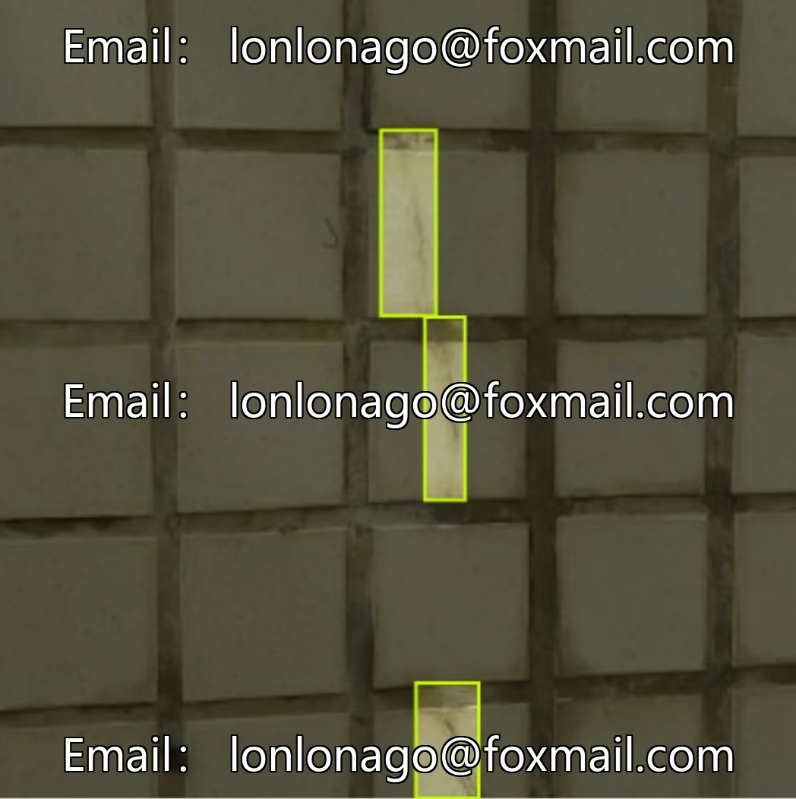
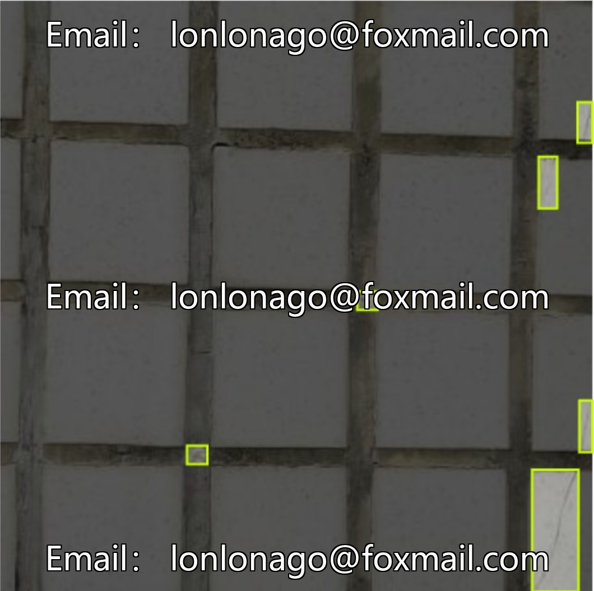
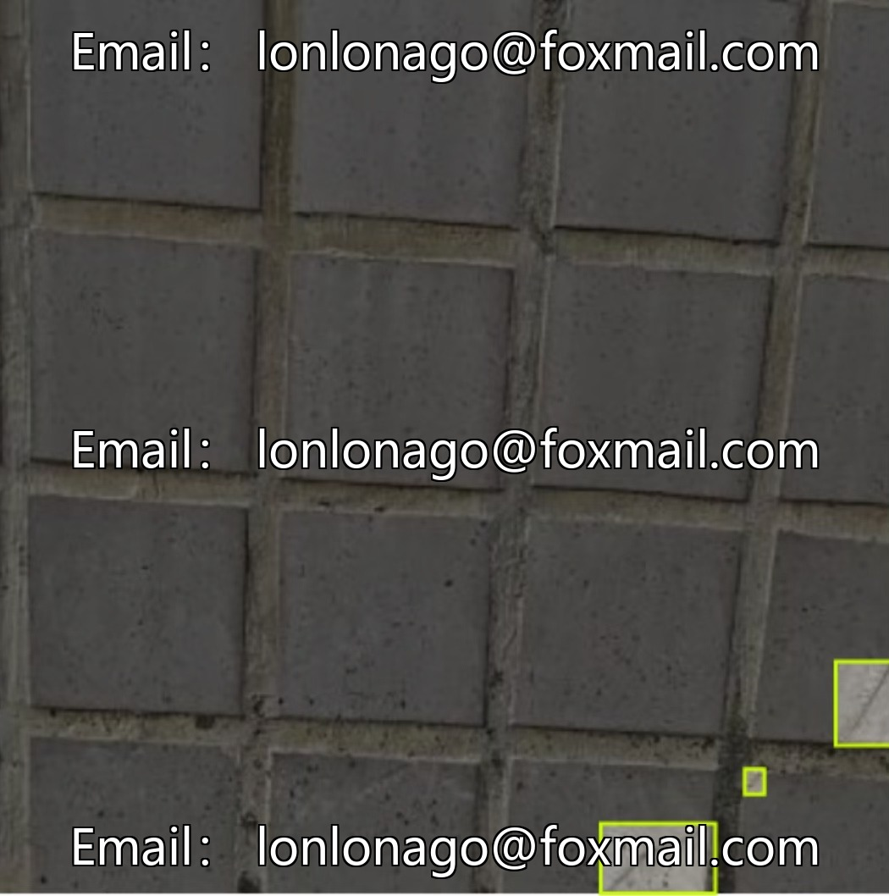
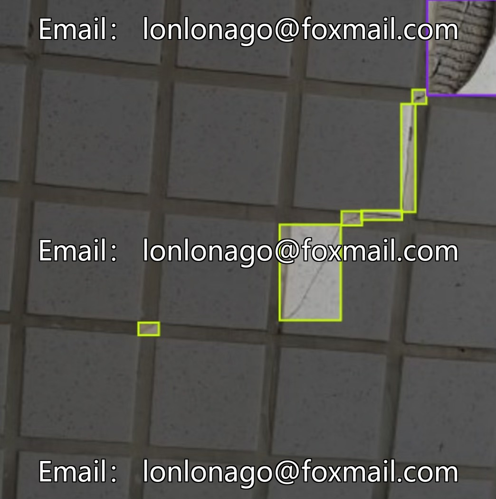

# Wall tile peeling dataset, 3040 images, including cracks, peeling, and falling off.

## Body

Wall tile peeling dataset, 3040 images, including three core defect categories: cracks, peeling, and falling off, suitable for AI model training and building quality inspection.

The dataset is a target detection dataset in the field of computer vision, formatted as JPG/PNG image files, and supports mainstream vision frameworks. The sample is rich, covering different scenarios, which can improve the efficiency and accuracy of model detection.

Virtual materials, once sold, are non-refundable.
Interested friends, click "I want" to proceed.

## Images

## Payment

Here is a pay link on Stripe ( https://buy.stripe.com/3cs8yP7sY87d0vu9AB ). Please contact me lonlonago@foxmail.com after funding $89, and I will send you a complete data files , thank you!

